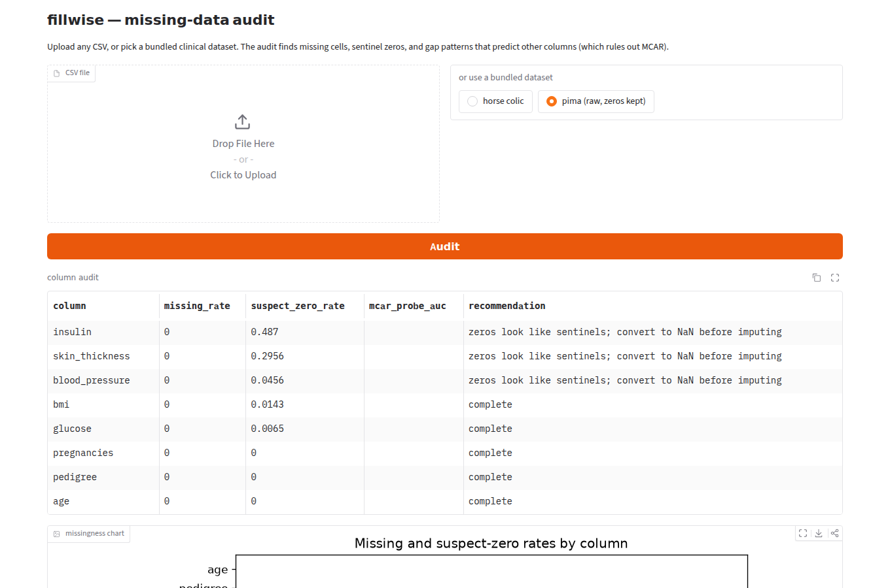
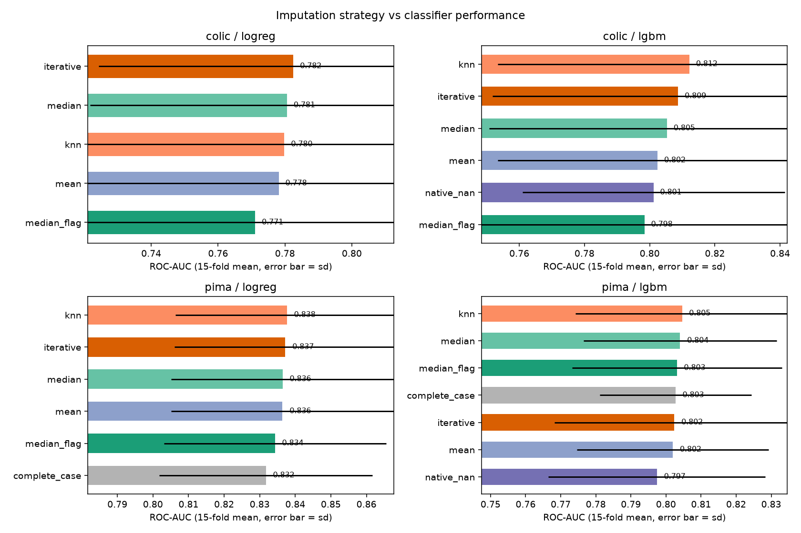
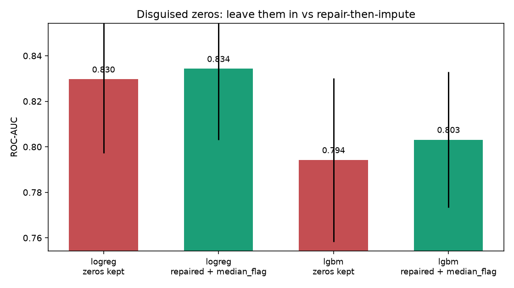
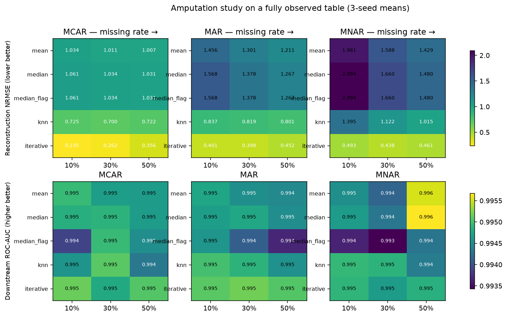

# fillwise

[](https://github.com/ranjithguggilla/fillwise/actions/workflows/ci.yml)

Missing data is the least glamorous problem in applied ML and probably the most common one.
fillwise is my attempt to treat it with the same rigor people reserve for model selection:
audit the gaps, figure out the mechanism behind them, then benchmark imputation strategies
inside leakage-safe pipelines instead of guessing.

The project has three parts:

1. an audit engine that measures missing rates, flags disguised sentinel zeros, and runs an
   MCAR probe (can a classifier predict which rows have gaps? if yes, the gaps are not random),
2. a strategy benchmark on two clinical datasets with genuinely messy missingness, and
3. a controlled amputation study where I punch MCAR/MAR/MNAR holes into a fully observed
   table and measure exactly how well each imputer recovers the truth.

Everything runs on CPU in about three minutes, every fit is tracked in MLflow, and every
number below came out of `scripts/run_all.py` on this repository's data.

## Demo

The Gradio app audits any CSV you drop on it: per-column missing rates, suspect zeros,
the MCAR probe, and a plain-language recommendation for each column.



Here it caught all three disguised-zero columns in the raw Pima table (insulin is 48.7%
zeros, which is obviously not a measurement) without being told anything about the data.

## Why this is worth doing

The horse colic dataset makes the case brutally. It has 299 rows, 21 clinical features,
and 25.5% of all cells missing. Exactly **6 rows are complete**. "Just drop rows with
missing values" — the default in a lot of production code I have seen — would throw away
98% of the data and cannot even fit a model. Meanwhile the missingness itself is
informative: my MCAR probe predicts which horses lack a nasogastric reflux pH reading with
AUC 0.845, because vets order invasive tests based on how sick the horse looks. That is
textbook MAR, and it means the gap pattern carries signal a model should see.

The Pima table has the opposite disease: not a single NaN in the file, but 376 of 768 rows
(49%) contain physiologically impossible zeros in glucose, blood pressure, skin fold,
insulin or BMI. Whoever exported it encoded "not measured" as 0 and the metadata never
mentions it.

## Results

### Strategy benchmark, 5-fold stratified CV repeated 3 times

ROC-AUC means over 15 folds. Same folds for every strategy, imputers fitted inside the
training fold only.

| strategy | colic / logreg | colic / lgbm | pima / logreg | pima / lgbm |
|---|---|---|---|---|
| complete_case | infeasible (5 rows) | infeasible | 0.832 | 0.803 |
| mean | 0.778 | 0.802 | 0.836 | 0.802 |
| median | 0.781 | 0.805 | 0.836 | 0.804 |
| median + indicator | 0.771 | 0.798 | 0.834 | 0.803 |
| kNN (k=5) | 0.780 | **0.812** | **0.838** | **0.805** |
| iterative (MICE-style) | **0.782** | 0.809 | 0.837 | 0.802 |
| LightGBM native NaN | — | 0.801 | — | 0.797 |



Honest reading: on real tables the differences between sensible imputers are small.
Paired fold-level tests against the median baseline (results/paired_deltas.csv) find
almost nothing significant at the 5% level — the exceptions are that the added indicator
columns actually *hurt* the colic models slightly (p = 0.03 for LightGBM), and LightGBM's
native NaN routing trails median imputation on Pima (p = 0.03). What is not small is the
cost of doing it wrong: complete-case analysis is impossible on colic and discards 49% of
Pima rows for no accuracy gain.

### Disguised zeros: leaving them in costs real AUC

| model | zeros kept | repaired + imputed | delta |
|---|---|---|---|
| logistic regression | 0.830 | 0.834 | +0.005 |
| LightGBM | 0.794 | 0.803 | +0.009 |



Small deltas, but they are free — the fix is three lines of preprocessing once you know
the zeros are sentinels, which is exactly what the audit is for.

### Amputation study: where imputer choice actually matters

I took the breast cancer table (569 rows, 30 features, zero missing cells), amputated the
ten mean_* columns under each mechanism at 10/30/50%, and measured reconstruction NRMSE on
the masked cells (imputers fitted on a train split, scored on held-out rows) plus
downstream CV AUC. Three seeds per cell.



Two findings I did not fully expect:

* Reconstruction quality separates dramatically even though downstream AUC does not.
  Iterative imputation reconstructs masked values at NRMSE 0.24–0.49 across mechanisms;
  median imputation sits at 1.03–2.09. Under MNAR at 10% the median imputer is off by two
  standard deviations per cell — it fills tail values with the middle of the distribution,
  which is precisely the failure mode MNAR creates.
* Downstream AUC stayed at 0.993–0.996 in every single configuration, against a 0.995
  ceiling on the intact table. This dataset has enough redundant, correlated features that
  a classifier shrugs off even 50% MNAR damage. The lesson cuts both ways: model metrics
  alone will not tell you your imputation is garbage, and if the imputed values feed
  anything else (dashboards, clinical review, downstream joins), reconstruction error is
  the number to watch.

## How it works

```
                     ┌───────────────────────┐
   CSV / dataset ───▶│  audit                │──▶ missing rates, suspect zeros,
                     │  (MCAR probe: predict │    MCAR-probe AUC per column,
                     │   the gap indicator)  │    recommendations
                     └──────────┬────────────┘
                                │
              ┌─────────────────┴──────────────────┐
              ▼                                    ▼
  ┌───────────────────────┐          ┌───────────────────────────┐
  │ benchmark (real data) │          │ amputation study          │
  │ 7 strategies ×        │          │ complete table + seeded   │
  │ {logreg, lightgbm} ×  │          │ MCAR/MAR/MNAR holes at    │
  │ 5×3 stratified CV     │          │ 10/30/50% → NRMSE on the  │
  │ imputers fit in-fold  │          │ masked cells + CV AUC     │
  └──────────┬────────────┘          └────────────┬──────────────┘
             │                                    │
             ▼                                    ▼
       MLflow (sqlite) ◀──── every fit ────▶ results/*.csv, metrics.json
                                                  │
                                                  ▼
                                          assets/*.png, Gradio app
```

The pieces worth calling out:

* Every strategy is a full sklearn `Pipeline`/`ColumnTransformer`; imputer statistics are
  learned from the training fold only. There is a test that asserts the fitted medians
  equal the train-fold medians and differ from the full-data ones, so leakage cannot creep
  back in silently.
* Complete-case is implemented the way it happens in production: incomplete rows dropped
  from training, residual test-time NaNs backfilled with training medians (a deployed model
  still has to score every incoming row). If deletion leaves under 30 rows or one class,
  the config is recorded as infeasible rather than fitted anyway.
* The MAR amputation uses a fully observed driver column (worst_area), so sicker-looking
  cases lose more measurements — the pattern real clinical data shows. MNAR masks a
  column's own large values, which is why mean/median imputation collapses there.
* Categorical handling is identical across strategies (mode + one-hot for the linear
  model, ordinal codes with NaN passthrough for LightGBM) so the comparison isolates the
  numeric imputation choice.

## Installation

```bash
git clone https://github.com/ranjithguggilla/fillwise.git
cd fillwise
uv venv -p 3.11 && uv pip install -e ".[dev]"
```

## Usage

Reproduce every number and chart in this README:

```bash
python scripts/run_all.py
```

Inspect the MLflow runs:

```bash
mlflow ui --backend-store-uri sqlite:///mlflow.db
```

Launch the audit app:

```bash
python -m fillwise.app     # http://localhost:7860
```

Use the pieces from code:

```python
from fillwise.data import load_colic
from fillwise.audit import audit_report
from fillwise.amputate import amputate
from fillwise.strategies import build_lgbm

ds = load_colic()
print(audit_report(ds.X))                       # rates, zeros, MCAR probes
pipe = build_lgbm("knn", ds.numeric, ds.categorical)
pipe.fit(ds.X, ds.y)                            # imputation happens in-pipeline
```

## Configuration

The experiment grid lives at the top of the relevant modules rather than in a config file,
since the study is the deliverable: `STRATEGIES` in strategies.py, `MECHANISMS`, `RATES`,
`SIM_STRATEGIES` and the MAR `DRIVER` in simulate.py, CV shape (5 splits × 3 repeats) in
benchmark.py, and the global seed (42) in strategies.py. The audit's suspect-zero
column-name hints and the MCAR-probe minimum gap count (15) are in audit.py.

## Output structure

```
results/
  audit_colic.csv, audit_pima.csv, audit_pima_raw.csv
  benchmark.csv          # one row per dataset × model × strategy × fold
  paired_deltas.csv      # fold-paired AUC deltas vs median, bootstrap CI + t-test
  amputation.csv         # mechanism × rate × strategy × seed
  metrics.json           # headline numbers used in this README
assets/                  # charts + app screenshots
mlflow.db                # created on first run, gitignored
```

## Project structure

```
src/fillwise/
  data.py         # loaders: colic ('?' markers), pima (zero repair), breast cancer
  audit.py        # missing rates, suspect zeros, MCAR probe
  amputate.py     # seeded MCAR/MAR/MNAR hole punching with rate calibration
  strategies.py   # 7 imputation strategies as leakage-safe pipelines
  benchmark.py    # repeated stratified CV, paired stats
  simulate.py     # amputation study on complete data
  plots.py        # all four charts
  app.py          # Gradio audit front end
scripts/run_all.py
tests/            # 47 tests
```

## Technical details

Python 3.11, scikit-learn 1.9.1, LightGBM 4.7.0, polars 1.44.2 (parsing and column
transforms), pandas 3.0.6 at the sklearn boundary, MLflow 3.16.1 with a sqlite backend,
matplotlib 3.11.2, Gradio 6.28.0. Dependencies are locked in uv.lock.

Determinism: global seed 42 through numpy, the CV splitters, LightGBM
(`deterministic=True, force_row_wise=True`) and the amputation RNG
(`numpy.random.default_rng`); a repeated run reproduces every metric exactly (only the
wall-clock timing columns differ), and there is a test asserting fold-level AUC equality
across back-to-back runs.
No pickle anywhere; results are CSV/JSON and models are refit from source.

Hardware: the full study (audits, 22 benchmark configs × 15 folds, 135 amputation
configurations, charts) takes ~177 s on a 4-core x86-64 cloud VM, no GPU. The heaviest
single piece is the IterativeImputer inside the amputation grid.

Statistical notes: fold-paired bootstrap CIs (2,000 resamples) and paired t-tests against
the median baseline; repeated CV means fold results are not independent, so I report both
and treat p-values as descriptive rather than gospel. The MCAR probe is a one-sided
instrument — high AUC rules MCAR out, but a low AUC cannot prove MCAR against MNAR, since
MNAR is by definition invisible in the observed data. That limit is why the amputation
study exists.

## Testing

```bash
ruff check src tests scripts
pytest -q        # 47 tests, ~60 s
```

The suite covers loader shapes and repair counts, amputation rate calibration and
mechanism properties (MNAR masks the tail, MAR follows its driver, the driver stays
observed), audit detection of planted sentinel zeros, MCAR-probe behavior on random vs
engineered gaps, every strategy pipeline fitting and scoring, the train-fold-only
leakage guard, complete-case infeasibility on colic, and seeded reproducibility.

## Data

* Horse Colic — McLeish & Cecile, University of Guelph; UCI Machine Learning Repository
  (CC BY 4.0). Mirrored from https://github.com/jbrownlee/Datasets.
* Pima Indians Diabetes — National Institute of Diabetes and Digestive and Kidney
  Diseases; originally distributed via UCI. Same mirror.
* Breast Cancer Wisconsin (Diagnostic) — UCI, bundled with scikit-learn; used as the
  fully observed ground truth for the amputation study.

## License

MIT — see [LICENSE](LICENSE).
